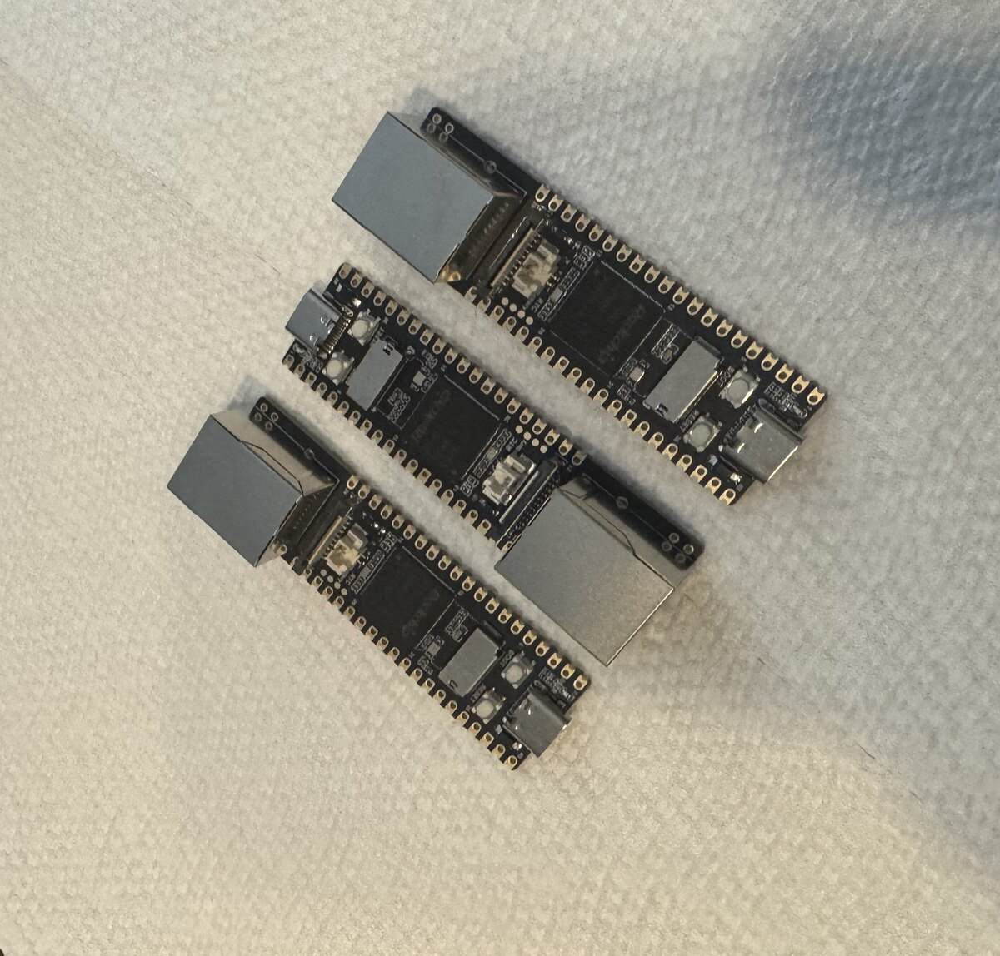
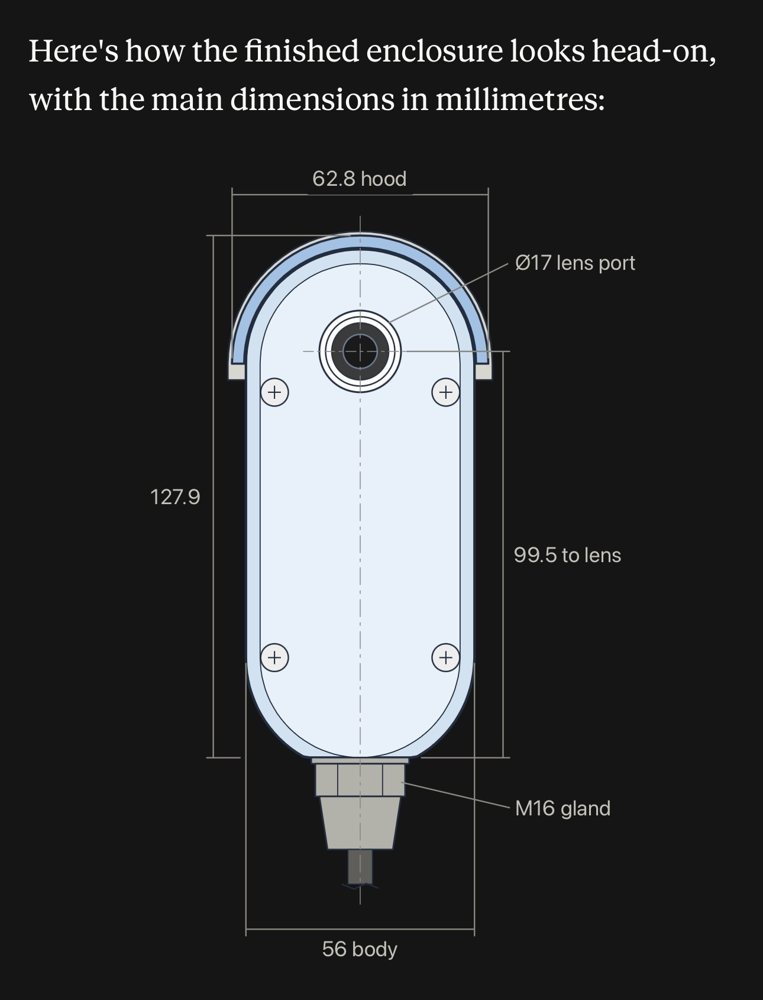
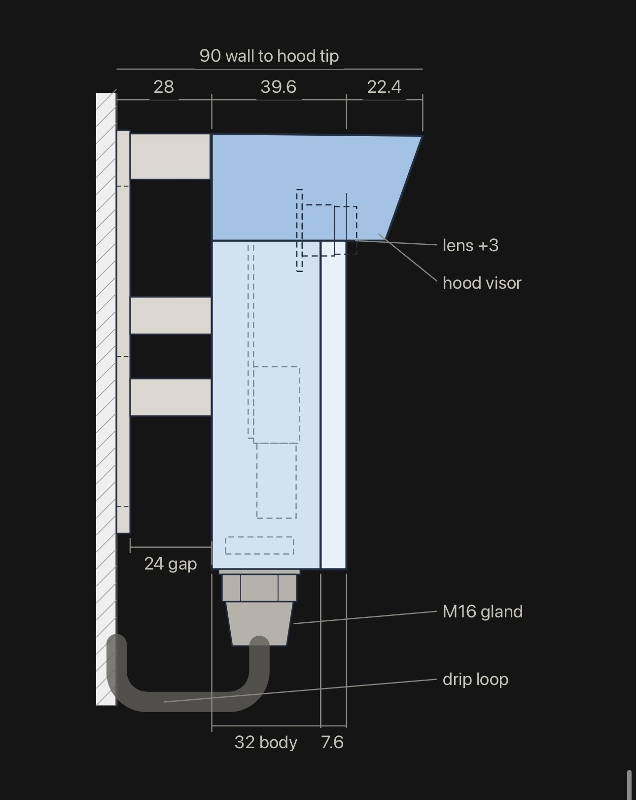

# Cyclops

**Many eyes. One watcher.**

Cyclops is a private, self-hosted home camera system built around small edge cameras and a central AI coordinator. It combines low-latency live video, human-presence detection, alert snapshots, and thermal self-management without sending camera footage to a cloud service.

The repository also contains the next-generation **LuckFox Pico Pro/Max eye**, including native RV1106 firmware and a parametric, 3D-printable outdoor enclosure.

## Highlights

- **Multi-camera live view** through a responsive web dashboard.
- **Edge-encoded video:** each camera produces a full-size viewing stream and a smaller detection stream.
- **On-device person detection** using a Hailo accelerator on the central Raspberry Pi 5.
- **Presence alerts** with snapshots through ntfy and optional Twilio SMS/MMS.
- **Thermal protection** that reduces streaming load before hardware watchdogs or reboots are needed.
- **Private networking** designed for a trusted LAN and Tailscale rather than direct Internet exposure.
- **Custom hardware:** native LuckFox firmware plus a support-free, five-part enclosure design.

## Architecture

The deployed system uses Raspberry Pi camera nodes, MediaMTX, and a FastAPI coordinator:

```text
┌──────────────────── Camera eye ────────────────────┐
│ Raspberry Pi Zero 2 W + IMX708                     │
│                                                    │
│ /cam     1536 × 864 H.264 ────────┐                │
│ /detect   640 × 360 H.264 ─────┐  │                │
│ Thermal governor + heartbeat   │  │                │
└────────────────────────────────│──│────────────────┘
                                 │  │ RTSP
                         ┌───────▼──▼────────────────────────┐
                         │ Raspberry Pi 5 coordinator        │
                         │                                   │
                         │ MediaMTX ──────► WebRTC dashboard │
                         │ Hailo detector ─► presence alerts │
                         │ FastAPI ────────► node management │
                         └───────────────────────────────────┘
```

Video is encoded once, in hardware, on each camera. The coordinator does not re-encode the viewing stream; person detection decodes only the lower-resolution detection feed.

## Hardware

| Role | Hardware | Purpose |
| --- | --- | --- |
| Current camera eye | Raspberry Pi Zero 2 W + IMX708 | Hardware H.264 video, registration, and thermal control |
| Coordinator | Raspberry Pi 5 + Hailo AI accelerator | Stream routing, person detection, alerts, and dashboard |
| Next-generation eye | LuckFox Pico Pro/Max (RV1106) + SC3336 | Compact, low-power camera with native dual-stream firmware |
| Network | LAN + Tailscale | Private connectivity between cameras, coordinator, and viewers |

## LuckFox eye and enclosure

<p align="center">
  
</p>

The LuckFox implementation uses the Rockchip media pipeline directly rather than Raspberry Pi camera abstractions. It publishes the same `/cam` and `/detect` stream contract as the existing eyes, with a 1920×1080 primary feed, a 640×360 detection feed, registration heartbeats, and a thermal governor.

The **v1.1 “fat pill” enclosure** is a parametric, wall-mounted design for the LuckFox board and SC3336 camera. It includes a sliding board sled, camera clamp, rain hood, wall bracket, sheltered louvres, an O-ring cover seal, and an M16 cable gland. All five printed parts are designed to print without supports.

<table>
  <tr>
    <td width="50%"></td>
    <td width="50%"></td>
  </tr>
  <tr>
    <td align="center"><em>Front dimensions and optical port</em></td>
    <td align="center"><em>Wall standoff, hood, and cable path</em></td>
  </tr>
</table>

The design is rain-resistant, not submersible, and has not been certified for an ingress-protection rating. Fit, sealing, UV resistance, and sustained operating temperature should be validated before permanent outdoor installation.

**Hardware resources:**

- [LuckFox firmware overview](firmware/luckfox-pico-pro/README.md)
- [Firmware build and provisioning runbook](firmware/luckfox-pico-pro/sdk-integration/RUNBOOK.md)
- [Enclosure v1.1 design, assembly, and hardware notes](hardware/luckfox-pico-pro/v1_1/DESIGN.md)
- [Printable v1.1 STL files](hardware/luckfox-pico-pro/v1_1/print/)

## Repository map

| Path | Contents |
| --- | --- |
| `deployed/` | Currently deployed FastAPI, MediaMTX, detector, and camera-node software |
| `apps/edge-camera/` | Next-generation FastAPI edge camera service |
| `apps/coordinator-api/` | Next-generation coordinator API and static UI host |
| `apps/coordinator-web/` | Responsive React camera dashboard |
| `packages/contracts/` | Shared TypeScript and JSON Schema contracts |
| `firmware/luckfox-pico-pro/` | Native RV1106 camera firmware and LuckFox SDK integration |
| `hardware/luckfox-pico-pro/` | Parametric enclosure sources, STLs, and design documentation |
| `config/examples/` | Example edge, coordinator, and camera-registry configuration |
| `ops/` | Release and deployment scripts |

The `deployed/` tree is the running system's lineage. The `apps/` tree is a separate coordinator/edge rewrite; they should not be treated as interchangeable deployments.

## Local development

### Prerequisites

- Python 3.11 and [uv](https://docs.astral.sh/uv/)
- Node.js and [pnpm](https://pnpm.io/)
- A camera is optional: the edge service includes a mock provider for development and CI

### Install

```bash
git clone https://github.com/designerGenes/cyclops.git
cd cyclops
uv sync
pnpm install --frozen-lockfile
```

Configuration templates are in [`config/examples/`](config/examples/). Keep real `.env` files, credentials, runtime configuration, and camera state out of Git.

### Run the services

Start the edge camera API on port 8050:

```bash
uv run uvicorn cyclops_edge.app:app \
  --app-dir apps/edge-camera/src --reload --port 8050
```

In a second terminal, start the coordinator API on port 8060:

```bash
uv run uvicorn cyclops_coordinator.app:app \
  --app-dir apps/coordinator-api/src --reload --port 8060
```

In a third terminal, start the web development server:

```bash
pnpm --filter coordinator-web dev
```

See [deployment notes](docs/operations/deployment.md) and the [deployed-system guide](deployed/coordinator/opt-cyclops/README.md) for device installation.

## Verification

```bash
# Python services and enclosure geometry
uv run pytest \
  apps/edge-camera/tests \
  apps/coordinator-api/tests \
  hardware/luckfox-pico-pro/tests

# Web unit tests
pnpm test

# Browser tests
pnpm --filter coordinator-web exec playwright test

# Portable LuckFox firmware core
cmake -S firmware/luckfox-pico-pro -B firmware/luckfox-pico-pro/build
cmake --build firmware/luckfox-pico-pro/build
ctest --test-dir firmware/luckfox-pico-pro/build --output-on-failure
```

## Security and project status

Cyclops is an actively developed personal project, and its hardware and deployment workflows are evolving. The dashboard and camera endpoints do **not** provide general user authentication. Keep them on a trusted LAN or Tailscale network and do not expose them directly to the public Internet.

Cyclops currently focuses on live viewing and presence alerts rather than continuous NVR-style recording. Configuration examples contain placeholders only; never commit enrollment tokens, Tailscale auth keys, WiFi passwords, notification tokens, or other credentials.
